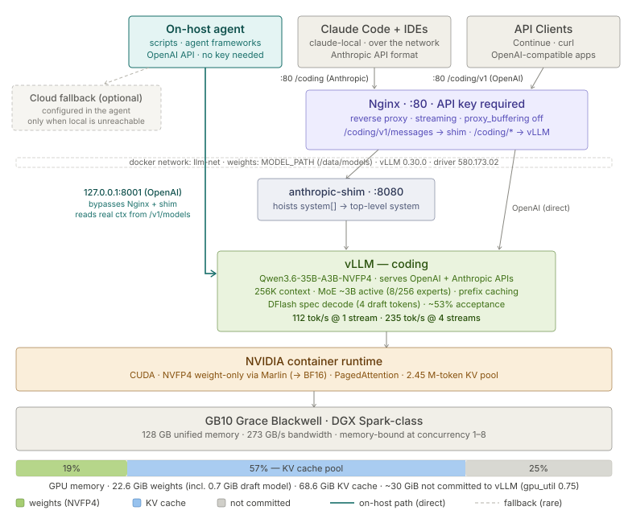

# DGX Spark — Qwen3.6 on vLLM, tuned for coding agents

A single-model vLLM inference server for an NVIDIA DGX Spark (or another GB10-based
128 GB box), managed with Docker Compose. It turns the machine into a private coding API
that speaks both the **OpenAI** API (`/v1/chat/completions`) and the **Anthropic** API
(`/v1/messages`), so Claude Code, IDE assistants and local agents can all use it.

- **Model:** [`nvidia/Qwen3.6-35B-A3B-NVFP4`](https://huggingface.co/nvidia/Qwen3.6-35B-A3B-NVFP4):
  a 35B mixture-of-experts model (~3B active per token), 4-bit NVFP4, 256K context, tool calling.
- **Speed:** ~112 tok/s for a single request, ~235 tok/s aggregate at 4 concurrent requests,
  using DFlash speculative decoding ([measured](#measured-performance)).
- **Front door:** nginx on port 80 with a required API key. A small stdlib-only shim fixes the
  one incompatibility between Claude Code and vLLM's Anthropic endpoint: Claude Code puts
  `system`-role messages inside `messages[]`, which vLLM rejects.



**Last validated:** 2026-10-04: vLLM 0.30.0, FlashInfer 0.7.1, driver 580.173.02, on a
GIGABYTE AI TOP ATOM (GB10, 128 GB). All seven checks in [`bench/validate.py`](bench/validate.py) pass.

The tuning targets agentic coding traffic, which is mostly tool calls and code edits. That
is why DFlash speculative decoding was chosen; [TUNING.md](TUNING.md) has the measurements.

## Documentation

| Doc | Read it for |
|-----|-------------|
| **README.md** (this file) | Quick start, connecting clients, day-to-day operations |
| [SETUP_GUIDE.md](SETUP_GUIDE.md) | The same setup in more detail, with verification at each step and troubleshooting |
| [IMPLEMENTATION_GUIDE.md](IMPLEMENTATION_GUIDE.md) | How the stack works and why each config choice was made |
| [TUNING.md](TUNING.md) | What drives speed on GB10, what was measured, what didn't help, and how to evaluate a new model or vLLM build |
| [bench/](bench/) | Benchmark harness, config sweeper, and the functional validation suite |

## Requirements

- **Hardware:** NVIDIA GB10 with 128 GB unified memory (DGX Spark or an OEM equivalent).
- **OS:** DGX OS. It ships with the NVIDIA driver (580.x is required for NVFP4), Docker,
  and the NVIDIA Container Toolkit already configured. On other Ubuntu installs, see
  [SETUP_GUIDE.md → Phase 1](SETUP_GUIDE.md#phase-1--system-dependencies).
- **vLLM image:** built locally from [`eugr/spark-vllm-docker`](https://github.com/eugr/spark-vllm-docker).
  This compose file needs **vLLM 0.26 or newer**, because it uses DFlash and
  `--safetensors-load-strategy`. It was validated on 0.30.0, and step 2 below builds exactly that.
- **Disk:** ~25 GB for model weights plus ~25 GB for the vLLM image.

---

## Quick start

### 1. Clone this repository

```bash
git clone https://github.com/trobdev/dgxspark-vllm-qwen.git ~/dgxspark-vllm-qwen
cd ~/dgxspark-vllm-qwen
```

### 2. Build the vLLM image (~40 minutes)

This builds the exact version validated here: vLLM v0.30.0, compiled from source. Stop
anything else using GPU memory first. A source build alongside a resident model ran the
box out of unified memory.

```bash
git clone https://github.com/eugr/spark-vllm-docker.git ~/spark-vllm-docker
cd ~/spark-vllm-docker
git checkout f7d6e3b       # build-script version used for the validated image
./build-and-copy.sh -t vllm-node-v2 --vllm-ref v0.30.0 --apply-preset-vllm-prs -j 8
cd ~/dgxspark-vllm-qwen
```

- **`-t vllm-node-v2` is required.** The script's default tag is `vllm-node`, which this
  compose file doesn't use.
- **FlashInfer isn't pinned by this command.** It comes from the build repo's prebuilt
  wheel, which was 0.7.1 when this stack was validated. To pin it as well, add
  `--flashinfer-ref v0.7.1`. That compiles FlashInfer from source too, which adds time.
- **Faster, unpinned alternative:** `./build-and-copy.sh -t vllm-node-v2` takes ~15–20
  minutes because it uses the build repo's current prebuilt wheels. You get whatever vLLM
  version those wheels are, which hasn't been validated here, so run step 6.

Check the result:

```bash
docker run --rm --runtime=nvidia vllm-node-v2:latest \
  python3 -c "import vllm, flashinfer; print(vllm.__version__, flashinfer.__version__)"
# validated build prints: 0.30.1.dev1+gbf1979fbd... 0.7.1
```

### 3. Configure

```bash
cp .env.example .env
sed -i "s/^LLM_API_KEY=.*/LLM_API_KEY=$(openssl rand -hex 32)/" .env
grep LLM_API_KEY .env      # every client needs this key
```

`.env` holds:

- `LLM_API_KEY` (**required**): nginx rejects any `/coding/` request without it, and
  `docker compose up` refuses to start if it's empty.
- `MODEL_PATH`: where the weights live. Defaults to `/data/models`.
- `HF_TOKEN`: optional. Both models are public, so you can leave it empty.

### 4. Download the models (~23 GB)

```bash
sudo mkdir -p /data/models && sudo chown $USER:$USER /data/models   # or your MODEL_PATH
./download-models.sh
```

This downloads the target model and the DFlash draft model, and you need both. The script
reads `.env`. It runs the Hugging Face CLI in a throwaway container if `hf` isn't
installed on the host. If a download is interrupted, re-run the script and it resumes.

### 5. Start

```bash
docker compose up -d
docker compose logs -f vllm-coding     # Ctrl-C once you see "Application startup complete."
```

The first start takes **6–8 minutes**, measured at 341–461s. It loads weights, allocates
the KV cache, compiles kernels, and runs autotuning. Later restarts reuse the `vllm-cache`
volume and take ~5 minutes (285–294s). nginx and the shim wait until vLLM is healthy.
The healthcheck allows 600s before it starts counting failures.

### 6. Validate

```bash
python3 bench/validate.py     # 7 checks, ~2 minutes; exits non-zero on failure
```

The checks cover tool calling, reasoning separation, recall from a ~242K-token prompt, the
Anthropic path through nginx and the shim, and streaming. The script uses only the Python
standard library.

---

## Connecting clients

| Protocol  | URL                                      | Model name | API key |
|-----------|------------------------------------------|------------|---------|
| OpenAI    | `http://<dgx-ip>/coding/v1`              | `coding`   | your `LLM_API_KEY` |
| Anthropic | `http://<dgx-ip>/coding` (base URL only) | `coding`   | your `LLM_API_KEY` |

`<dgx-ip>` is the Spark's address on your network (`hostname -I`), or `localhost` on the Spark itself.

### OpenAI SDK

```python
from openai import OpenAI

client = OpenAI(base_url="http://<dgx-ip>/coding/v1", api_key="<LLM_API_KEY>")

response = client.chat.completions.create(
    model="coding",
    messages=[{"role": "user", "content": "Write a binary search in Python."}],
)
print(response.choices[0].message.content)
```

**Thinking is on by default.** The model reasons before answering, and the reasoning comes
back in a separate `reasoning` field. Turn it off for faster, simpler replies:

```python
response = client.chat.completions.create(
    model="coding",
    messages=[{"role": "user", "content": "Say ok."}],
    extra_body={"chat_template_kwargs": {"enable_thinking": False}},
)
```

Tested: this produces 0 reasoning tokens. A `/no_think` system message does **not** work
with Qwen3.6; reasoning still runs.

### Claude Code

Add an alias to `~/.bashrc` or `~/.zshrc`:

```bash
alias claude-local='env -u ANTHROPIC_API_KEY \
  ANTHROPIC_BASE_URL=http://<dgx-ip>/coding \
  ANTHROPIC_AUTH_TOKEN=<LLM_API_KEY> \
  ANTHROPIC_DEFAULT_OPUS_MODEL=coding \
  ANTHROPIC_DEFAULT_SONNET_MODEL=coding \
  ANTHROPIC_DEFAULT_HAIKU_MODEL=coding \
  claude'
```

Run `claude-local` for the local model and plain `claude` for Anthropic's API. Tested with
Claude Code 2.1.233.

- **`ANTHROPIC_AUTH_TOKEN`** sends the key as `Authorization: Bearer`, which nginx accepts.
- **`env -u ANTHROPIC_API_KEY`** keeps a real Anthropic key, if you have one exported, from
  also being sent to this server in plain HTTP.
- **The `ANTHROPIC_DEFAULT_*_MODEL` variables** map Claude Code's opus, sonnet and haiku
  slots to the served model name `coding`.
- **Context window:** Claude Code assumes a 200K-token window for a model name it doesn't
  recognise, and compacts the conversation to stay inside it. The server allows 262,144
  tokens, so it has margin. Leave `CLAUDE_CODE_MAX_CONTEXT_TOKENS` unset, or keep it well
  below 262,144, because the prompt plus the output must fit.

### Cursor, Continue, and other IDE tools

Set the OpenAI base URL to `http://<dgx-ip>/coding/v1`, the model to `coding`, and the
API key to your `LLM_API_KEY`. For Continue (`~/.continue/config.yaml`):

```yaml
models:
  - name: Qwen3.6 Coding (local)
    provider: openai
    model: coding
    apiBase: http://<dgx-ip>/coding/v1
    apiKey: <LLM_API_KEY>
    requestOptions:
      extraBodyProperties:
        chat_template_kwargs:
          enable_thinking: false   # skip reasoning for IDE edits
    roles: [chat, edit]
```

### Agents on the same machine

A process running on the Spark itself can skip nginx and the key, and call vLLM directly at
`http://localhost:8001/v1` using the OpenAI API. That port is bound to `127.0.0.1` only.
The context window there is reported at `/v1/models`.

---

## Measured performance

GIGABYTE AI TOP ATOM (GB10, 128 GB unified, driver 580.173.02), vLLM 0.30.0, the config in
`docker-compose.yml` as shipped. Measured 2026-10-04, n=14 per workload.

**Decode rate by workload**, single request (c=1), in tokens per second:

| Workload | tok/s | What it represents |
|---|---|---|
| `code_edit` | 121.7 | modify a file, reproduce surrounding context |
| `tool_call` | 115.8 | agentic tool invocation, JSON arguments |
| `reasoning` | 109.0 | general analysis |
| `prose` | 99.0 | novel, unpredictable text |
| **Headline (median of medians)** | **112.4** | |
| **4 concurrent requests, aggregate** | **234.8** | |

Speculative acceptance: **53.0%** (DFlash, 4 draft tokens).

**What the tuning bought.** Same hardware and model, on vLLM 0.26.1 (n=14 for the finalists):

| Configuration | c=1 tok/s | c=4 aggregate |
|---|---|---|
| No speculative decoding | 77.3 | 181.3 |
| DFlash, 15 draft tokens (upstream recipe default) | 104.8 | 174.3 |
| MTP, 3 draft tokens | 108.9 | 208.8 |
| **DFlash, 4 draft tokens (deployed)** | **111.4** | **227.8** |

The upstream default draft length was *slower than no speculation at all* at c=4. The
upgrade from vLLM 0.26.1 to 0.30.0 changed nothing measurable; every delta was inside the noise floor.

**Other measured figures:**

| | |
|---|---|
| Long-context recall | 241,815-token prompt, specific line retrieved verbatim |
| Cold start (container start → serving) | 341–461s; 347s on the first 0.30.0 start |
| Warm recreate (`vllm-cache` volume populated) | 285–294s |
| GPU memory committed by vLLM | ~91 GiB of ~121 GiB usable (`--gpu-memory-utilization 0.75`) |

**How these were measured:**

- **Decode rate only.** Requests are streamed and time-to-first-token is excluded, so prefill
  and prefix-cache hits don't inflate the number.
- **Conditions:** temperature 0, prompts drawn from a real agent workload, medians over n trials.
- **Noise:** run-to-run noise is about ±2–3% at c=1 and ±7% at c=4, so smaller differences
  are not meaningful.
- **Workload choice matters more than most config changes:** `prose` and `code_edit` differ
  by ~20% on identical settings.

Reproduce with `python3 bench/bench.py <label> 14`. The full method and results are in
[TUNING.md](TUNING.md).

---

## Day-to-day operations

| Task                    | Command                                       |
|-------------------------|-----------------------------------------------|
| Start                   | `docker compose up -d`                        |
| Stop                    | `docker compose down`                         |
| Restart model only      | `docker compose restart vllm-coding`          |
| View live logs          | `docker compose logs -f vllm-coding`          |
| Health (direct, on host)| `curl http://localhost:8001/health`           |
| Health (through nginx)  | `curl http://localhost/health`                |
| GPU memory in use       | `nvidia-smi --query-compute-apps=pid,process_name,used_memory --format=csv` |
| Validate after a change | `python3 bench/validate.py`                   |

On GB10, `nvidia-smi --query-gpu=memory.used` reports `[N/A]` because memory is unified.
Use the per-process query above, or `free -h` for the whole box.

Containers use `restart: "no"` on purpose, so a crash stays visible instead of
restart-looping. To have the stack come back after a reboot, change it to
`restart: unless-stopped`, or use the systemd unit in
[SETUP_GUIDE.md → Phase 7](SETUP_GUIDE.md#phase-7--optional-system-autostart).

---

## GPU memory

With `--gpu-memory-utilization 0.75`, vLLM commits ~91 GiB of the ~121 GiB usable pool:

| Allocation                | Approx size  |
|---------------------------|--------------|
| NVFP4 weights             | 21.9 GiB     |
| DFlash draft model        | 0.7 GiB      |
| KV cache + activations    | 68.6 GiB     |
| Not committed to vLLM (OS, Docker, other processes) | ~30 GiB |

Measured live at 93,381 MiB. vLLM reports a KV pool of 2,453,340 tokens, which is about
**9 concurrent sequences at the full 256K context**, and proportionally more at shorter ones.

**Why 0.75 rather than higher.** The memory is unified: the OS and every other process
share the same pool, and host usage grows over days of uptime. At 0.85 the whole box sat at
~122 GB of 128 GB with no margin. At 0.75, ~17 GiB of host memory stays free. Higher
utilization buys KV capacity, **not throughput**, so the headroom costs nothing in tokens per second.

If the model runs out of memory at startup, lower `--gpu-memory-utilization` before
reducing `--max-model-len`. See
[IMPLEMENTATION_GUIDE.md](IMPLEMENTATION_GUIDE.md#throughput-expectations-and-limitations)
for why 262144 is set deliberately.

---

## Security

- **API key required.** nginx returns `401` for any `/coding/` request without
  `LLM_API_KEY`, sent either as `Authorization: Bearer` or as `x-api-key`. `/health` and `/`
  are open, but they only return fixed text.
- **Port 80 is on all interfaces and Docker bypasses ufw.** Ports Docker publishes are not
  filtered by ufw, so your network boundary and the key are what protect the API. If only
  this machine needs access, change the mapping to `"127.0.0.1:80:80"` in `docker-compose.yml`.
- **No TLS by default.** Port 80 is plaintext, so the key and your prompts, including source
  code, cross the network unencrypted. On any network you don't fully trust, enable the
  HTTPS block in [`nginx/default.conf.template`](nginx/default.conf.template). Better still,
  reach the box over a VPN such as Tailscale or WireGuard.
- **The direct ports are loopback-only.** vLLM on `127.0.0.1:8001` and the shim on
  `127.0.0.1:8003` have no auth. Keep them bound to loopback.
- **Do not port-forward this to the internet.** It is built for one developer or a trusted LAN.

## Swapping the model

1. Download the new weights to `MODEL_PATH`.
2. Update `--model` and `--served-model-name` in `docker-compose.yml`. `HF_HUB_OFFLINE=1`
   is set, so `--model` must be a local path under `/models`, not a hub ID.
3. Remove or replace `--speculative-config`. The DFlash draft model is specific to
   Qwen3.6 and won't work with another model.
4. Drop `--reasoning-parser`, `--tool-call-parser` and `--language-model-only` if the new
   model doesn't use Qwen3's formats.
5. Run `docker compose up -d --force-recreate vllm-coding`, then `python3 bench/validate.py`.
   The checks assume `max_model_len=262144` and a reasoning model, so adjust them as needed.
6. If you add a draft model, re-sweep `num_speculative_tokens`. See
   [TUNING.md §4.1](TUNING.md#41-speculative-decoding--the-lever-that-moved).

## Updating the vLLM image

```bash
docker tag vllm-node-v2:latest vllm-node:v2-previous   # keep a rollback; the build reuses the tag
docker compose stop vllm-coding                        # frees ~91 GiB before a source build
cd ~/spark-vllm-docker && git pull
./build-and-copy.sh -t vllm-node-v2 --vllm-ref <tag> --apply-preset-vllm-prs -j 8
cd ~/dgxspark-vllm-qwen && docker compose up -d && python3 bench/validate.py
```

- **Why stop vLLM first:** a from-source build at `-j 8` next to the resident model
  triggered the kernel OOM killer twice. With the model stopped, the same build finished in
  39m42s with no OOM events.
- **Rollback:** set `image: vllm-node:v2-previous` in `docker-compose.yml`, then run
  `docker compose up -d`.
- **After upgrading:** benchmark before and after (see
  [TUNING.md §7](TUNING.md#7-evaluating-a-new-model-or-vllm-build)).

## License

[MIT](LICENSE)
